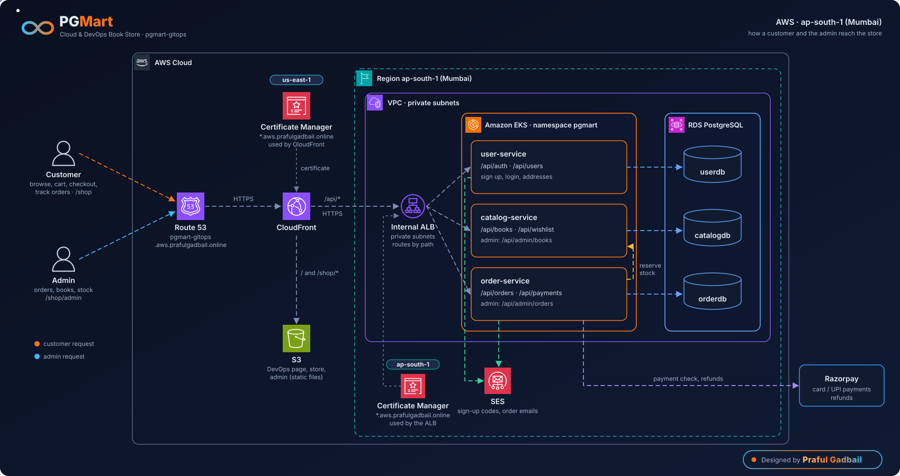

<p align="center">
  
</p>

<p align="center">
  Microservices e-commerce app on AWS EKS.<br>
  Modern GitOps with GitHub Actions, SonarQube Cloud, Trivy, Argo CD, Helm and Karpenter autoscaling.
</p>

<p align="center">
  
  
  
  
  
  
  
  
  
  
</p>

## About

A working online book store (customers order and pay, an admin runs orders and stock) used to show how a real application is built, secured and run on AWS: CI with GitHub Actions, GitOps deployment to Amazon EKS with Argo CD.

## Architecture



| Step | Where | What happens |
|---|---|---|
| 1 | **Route 53** | `pgmart-gitops.aws.prafulgadbail.online` points to CloudFront |
| 2 | **CloudFront** | One HTTPS address for the whole site. Its certificate (`*.aws.prafulgadbail.online`) comes from **ACM in us-east-1**, the only region CloudFront accepts |
| 3 | **S3** | `/` (DevOps page) and `/shop/*` (store and admin): static files in a private bucket |
| 4 | **Internal ALB** | `/api/*` reaches the ALB over HTTPS through a CloudFront VPC origin. The ALB sits in private subnets, has no public address, and uses a second certificate from **ACM in ap-south-1**. It sends each path to the right service |
| 5 | **EKS** | user-service, catalog-service and order-service run in namespace `pgmart` |
| 6 | **RDS PostgreSQL** | Each service has its own database: `userdb`, `catalogdb`, `orderdb` |
| 7 | **SES** and **Razorpay** | Sign-up codes and order emails; online payments and refunds |

The ALB is created from the Kubernetes Ingress by the AWS Load Balancer Controller, which makes it internal unless told otherwise. The customer and the admin use the same address; the admin only sees the admin dashboard.

## CI/CD



CI and CD are split. **GitHub Actions** builds, tests, scans and pushes the image, then writes the new image tag to a separate **config repository** (`pgmart-gitops-config`: Helm values and Argo CD applications). **Argo CD**, running inside EKS, watches that repository and rolls out whatever it says. CI never gets access to the cluster, and every deployment is a Git commit that can be reviewed or reverted.

Code quality is checked by **SonarQube Cloud**, one project per service and one for the frontend. GitHub Actions signs in to AWS with **OIDC**: a short-lived role for each run, no AWS keys stored in GitHub. Each service and the frontend has its own workflow, so a change in one service builds and deploys only that service.

**Backend**: `.github/workflows/<service>.yml`

| # | Stage | What happens |
|---|---|---|
| 1 | Checkout | `actions/checkout` |
| 2 | Secret scan | **Gitleaks**: stops if a password or key was committed |
| 3 | Build and unit test | **Maven**: `mvn verify`, test coverage with **JaCoCo** |
| 4 | SonarQube Cloud | Bugs, vulnerabilities, code smells, duplication and coverage, checked by the **Quality Gate**; pull requests get a summary comment |
| 5 | Dependency scan | **Trivy** `fs`: known vulnerabilities in the Maven dependencies (`pom.xml`) |
| 6 | Docker build | **Docker Buildx** |
| 7 | Image scan | **Trivy** `image`: stops on HIGH or CRITICAL |
| 8 | Push to ECR | Image tagged with the Git commit |
| 9 | Update image tag | Commits the new tag to the service's values file in the config repository |
| 10 | Argo CD sync | Argo CD sees the commit and rolls out the new version in namespace `pgmart` |

**Frontend**: `.github/workflows/frontend.yml`. No container and no Argo CD: Checkout → Gitleaks → `npm ci` → type check and tests (Vitest coverage) → SonarQube Cloud and Quality Gate → `npm run build` → Trivy `fs` → upload to S3 (OIDC) → CloudFront invalidation, so visitors get the new version at once.

## Tech stack

| Area | Tools |
|---|---|
| Application | Java 21 · Spring Boot (3 services) · React + TypeScript · PostgreSQL |
| Containers | Docker (multi-stage, non-root) · Amazon ECR |
| Kubernetes | Amazon EKS · Helm · AWS Load Balancer Controller · External Secrets |
| AWS | VPC · Route 53 · ACM · CloudFront · S3 · RDS · Secrets Manager · SES |
| CI/CD | GitHub Actions · SonarQube Cloud · Trivy · Gitleaks · Argo CD |

## Repository layout

```
services/
  user-service/        Java 21, Spring Boot · src/, pom.xml, Dockerfile
  catalog-service/     same layout
  order-service/       same layout
frontend/              DevOps page and store · React, TypeScript
.github/workflows/     CI: one workflow per service and the frontend; reusable-java-service.yml is the shared Java pipeline
docs/                  diagrams and logo
local/                 database setup for docker compose
docker-compose.yml     the whole app on a laptop
```